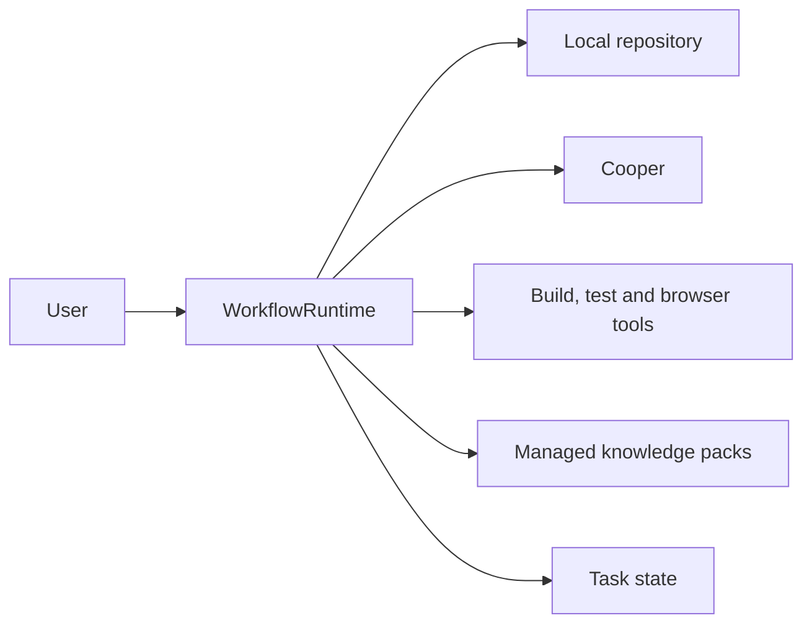
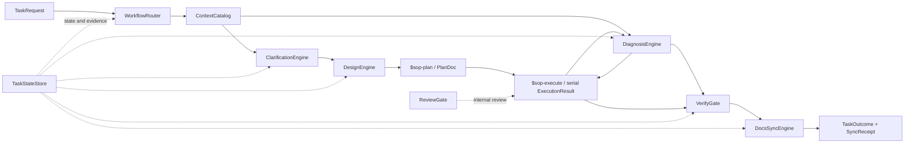
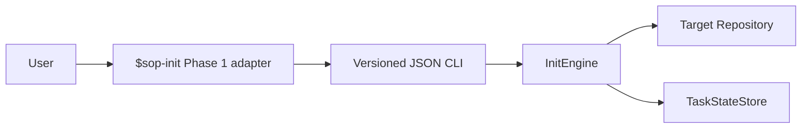

# Architecture

> Status: sections explicitly labeled **0.2 implemented** describe the remaining
> Init and TaskStateStore runtime slices. **0.2.3 implemented** adds Init identity
> isolation and confirmation gates. **0.3 implemented**
> additionally covers the plugin Collector Hook, append-only Execution Trace,
> runtime event adapter and automatic post-verification Docs Hook. **Current
> 0.4.0** implements the Git requirement document and exact approval handoff.
> The former 0.2/0.2.3 clarification persistence slice is Historical. The
> end-to-end WorkflowRuntime, ContextCatalog, structured Design/Verify/Docs
> modules, and future PlanDoc/cursor recovery are **Planned V1**. No
> ExecutionEngine interface has been selected; Current prompt-driven Skills do
> not make the other planned modules implemented.

## Architectural thesis

AI Native DevKit is one deep workflow module with a small user interface and substantial hidden behavior. Users choose an intent such as initialize, clarify, design, execute or debug; they do not coordinate upstream Skill workflows, state stores, context sources, review agents or documentation writes themselves.

The external interface is the command set plus its invariants, approval points, error modes and evidence contract. Stage engines and adapters are internal seams.

## Planned V1 system context



## Planned V1 end-to-end flow



In Planned V1, Fast and Standard tiers skip stages that are not required; they
still converge on verification and documentation-impact analysis. The Current
`$coding-sop` prompt router already classifies `intent` as `development` or
`debug`, selects `workflowTier` as `fast`, `standard` or `strict`, and projects
the compatibility `route` as `lightweight`, `development` or `debug`. Planned
V1 adds automatic risk scoring and persisted `RouteDecision` state; it does not
introduce a second routing vocabulary.

Plan and Execute in this diagram use the Current prompt-Skill interfaces. Plan
returns a detailed DesignDoc-derived Markdown PlanDoc. Execute consumes its
ordered vertical slices serially, performs one end-of-plan two-axis review, and
returns `ExecutionResult`. The calling router, not Execute, owns Verify, Docs
Sync, and the terminal `TaskOutcome`. Durable PlanDoc loading and per-slice
resume/recovery remain Planned V1 and have no engine or ledger interface yet.

### 0.2 implemented runtime slice

The implemented S0 slice covers the read-only Phase 1 runtime behind
`$sop-init`. It does not implement WorkflowRuntime or WorkflowRouter and does
not produce a `RouteDecision`.



The Target Repository must be a non-bare Git worktree. S0 normalizes it to the
Git top-level and reads it without creating or modifying repository files.
Unborn, dirty and detached worktrees are eligible, and a selected submodule is
its own Target Repository. A non-Git directory or bare repository produces a
typed blocked report; `$sop-init` does not initialize, clone, create a checkout,
stash, clean, reset or commit. The prompt-driven Phase 2 Bootstrap, Adapt and
Refresh docs workflow is Current and may write only after preview and approval;
its deterministic `ContextCatalog`/runtime integration and reusable
`ContextBundle` behavior remain S1 work. If Phase 2 writes project docs, it
creates a new read-only post-write task/report before handing context downstream.

### Historical clarification persistence

Before 0.4.0, the 0.2 clarification slice reused TaskStateStore and persisted
immutable `draft` checkpoints while questions remained. The 0.2.3 hardening then
persisted an exact `approval_requested` checkpoint without a lifecycle
transition. The then-current Skill owned the mandatory boundary that presented
the complete baseline and ended the assistant turn; the runtime owned persisted
ordering and exact-reference freshness. After a later user-authored approval,
finalization atomically committed caller-asserted approval evidence, the final
`ClarificationResult`, and the `ContextReady -> Clarified` transition. The host
at that time supplied no host-attested user-turn proof. A later session had to
load the result with the explicit `task_id` and exact `ArtifactRef`; repository
path was never a task selector. These contracts are retained here as history only: the implementation,
registry, CLI operations, and public Skill surface no longer support them, and
existing external state is neither migrated nor deleted.

### 0.3 implemented observability and Docs Hook slice

The plugin bundles `hooks/hooks.json` and a fail-open Collector Handler for all
supported Codex Session, Turn, Tool, Permission, Compact and Subagent lifecycle
events. The Handler first checks for an active `coding-sop` Trace created by a
validated `workflow.started` runtime event. Before that activation it returns
success without creating Trace state, so non-plugin Sessions are not persisted.
After activation, Codex Hook input is converted into bounded `codex_hook` events
without persisting prompt text, command input, raw tool output or assistant messages.
Validated workflow decision points emit `devkit_runtime` events. The Init CLI
and docs validator automatically own the two ends of the Init run, including a
private before/after docs inventory. `workflow_cli.py` owns Clarify approval and
stage facts. `runtime_cli.py` validates route, typed stage transitions, Design
and Plan approvals, verification, Docs Hook and workflow-completion facts.
Skills invoke these control operations but do not compose logs or display
Trace-only routing/status text. `workflow.finish` rejects a completed result
unless the route's required stages ran in order, required approvals passed,
verification passed, and Docs work is terminal. Runtime events inherit
the active structured Host turn and the enclosing
tool call when it is unambiguous. The old Agent-maintained `EvaluationTrace`,
evaluation oracle fields and `evaluation_cli.py` have been removed.

`ExecutionTraceStore` maintains `session_id 1:1 trace_id` for activated plugin
Sessions, assigns monotonic
event sequence numbers under a per-session lock, appends full events to
`events.jsonl`, and deterministically rebuilds `summary.json`. A plugin Runtime
`workflow.started` event is a complete activation boundary; an unexpected
Runtime-first event or transcript fallback is marked partial rather than guessed complete.

`verification.complete` emits the verified result and, only after a pass,
invokes `DocsImpactHook` in the same program call. The Hook derives changed paths
from Git and classifies `NO_CHANGE`, `DETERMINISTIC`, `SEMANTIC_REVIEW` or
`CONFLICT`. A private Docs Sync before/after inventory supplies exact changed
document paths without an Agent log payload. Routine bugs, tests, internal
refactors and temporary files result in no docs question. Semantic writes still
require a full preview and user approval. The normal workflow never proposes
Handoff work. Human-facing Handoff documents are outside plugin scope; there
is no Handoff Skill, observer, approval, or path-based Hook gate. Historical
trace events remain readable without reactivating that workflow.

## External interface

The **Planned V1** top-level module is:

```text
WorkflowRuntime.run(TaskRequest) -> TaskOutcome
WorkflowRuntime.resume(TaskID)    -> TaskOutcome
WorkflowRuntime.status(TaskID)    -> TaskStatus
```

The interface includes these caller-visible facts:

- exactly one route and current stage exist for a task;
- user authority is requested before destructive actions, scope expansion or semantic publication;
- a paused task is resumable from persisted stage output;
- completion means VerifyGate passed and docs impact was resolved;
- failures distinguish retryable environment failure, blocked decision, rejected invariant and implementation failure;
- full private reasoning and secrets are not persisted in task state.

The 0.2 `$sop-init` adapter still invokes its bounded Init runtime directly.
Current `$sop-clarify` adapts to the Git requirement and Trace boundary through
`RequirementDocumentWriter`, `RequirementApprovalGate`, and
`RequirementDocumentLoader`; it does not invoke the Historical clarification
runtime. Commands such as `$sop-design` and `$sop-debug` remain prompt-driven
Current capabilities until they become thin adapters into Planned V1
WorkflowRuntime.

For S0, Phase 1 of `sop-init/SKILL.md` is the user-facing runtime adapter. It
owns activation, ready-task choices and concise Markdown rendering. It invokes
one plugin-owned CLI entry point using versioned JSON. The init CLI adapter owns
explicit-versus-implicit identity resolution and initial-only collision
isolation. `InitEngine` keeps repository-target binding strict and owns
inspection, blockers, freshness, reuse/new choices, and resume. The CLI never
emits a second authoritative Markdown result. Phase 2 is the separate Current
prompt-driven docs workflow.

## Deep modules

### Current 0.4.0 Clarify/Design boundary

`$coding-sop` remains the only orchestrator. `$sop-clarify` owns dialogue;
`RequirementDocumentWriter` hides safe path creation and the one-file Git
commit; runtime Trace owns exact later-turn approval; and
`RequirementDocumentLoader` hides repository, Git identity, approval, and
source-freshness checks. TaskStateStore is not part of this clarification path.
Requirements files are versioned workflow records rather than canonical
CurrentState.
The boundary is 0.4.0 implemented. Other rows explicitly marked as planned
remain Planned V1 module boundaries.

| Module | Small interface | Hidden implementation |
|---|---|---|
| WorkflowRouter | `route(TaskSignals) -> RouteDecision` | risk scoring, mandatory upgrades, user override, stage selection |
| ContextCatalog | `resolve(ContextRequest) -> ContextBundle` | docs routing, source metadata, code/doc drift detection, token budgeting, source refresh |
| InitEngine | one CLI entry point returns `report`, `choice_required` or `runtime_error` | Git inspection, readiness and blocker policy, freshness choices, blocked resume, report construction |
| TaskStateStore | `load(task_id)`, `commit(TaskCommit)` | contract decoding, reference integrity, transition validation, hashing, redaction, idempotency, atomic persistence, recovery and corruption checks |
| ExecutionTraceStore | `append`, `load_session`, `load_events`, `load_summary` | session mapping, private storage, locking, full events, capture status and deterministic projection |
| CollectorService | `collect_codex`, `emit_runtime` | Codex Hook/runtime adapters, event whitelist, correlation, redaction and docs-read facts |
| DocsImpactHook | `after_verification` | Git changed-path evidence, cheap impact classification and semantic approval signals |
| RequirementDocumentWriter | `write_and_commit(...) -> RequirementDocRef` | safe path creation, one-file native Git commit, dirty-worktree preservation and exact blob identity |
| RequirementApprovalGate | `require_approved(...)` | coherent Trace projection, later-user-turn proof, repository and exact-subject binding |
| RequirementDocumentLoader | `verify_current(...)`, `load_approved(...)` | repository/path/commit/blob verification, approval lookup, stable snapshot and source freshness |
| ClarificationEngine (Planned V1) | clarify the first appropriately scoped request | question ordering and conflict detection without a structured clarification baseline |
| DesignEngine (Planned V1) | `design(RequirementDocRef) -> DesignResult` | alternatives, common comparison, interface design, approval ledger, spec lint |
| Plan Skill adapter (Current) | `plan(approved DesignDoc) -> PlanDoc` | design translation, acceptance coverage, ordered vertical slicing, risk-driven detail |
| Execute Skill adapter (Current) | `execute(approved PlanDoc, DesignDoc) -> ExecutionResult` | one baseline, serial behavior-first slices, focused checks, candidate commit, bounded two-axis review |
| DiagnosisEngine | `diagnose(DebugRequest) -> DiagnosisResult` | feedback-loop selection, minimization, hypothesis ranking, probes and cleanup |
| ReviewGate | `evaluate(ChangeSet, Baseline) -> ReviewReport` | independent Spec and Standards reviews, finding reconciliation |
| VerifyGate | `evaluate(AcceptanceSet, EvidenceSet) -> VerificationReport` | freshness, applicability, denominator accounting and environment gaps |
| DocsSyncEngine | `plan(TaskOutcome) -> DocImpactReport`; `apply(ApprovedDocChanges) -> SyncReceipt` | doc routing, deterministic updates, semantic preview, conflicts and link validation |

The interfaces are the test surfaces. Tests should survive changes to internal prompting, model choice, persistence implementation and sub-agent strategy.

## Real seams and adapters

Only dependencies that genuinely vary receive adapters.

| Seam | Production adapter | Test adapter | Reason |
|---|---|---|---|
| Repository | filesystem/git adapter | fixture repository adapter | controlled file and revision behavior |
| Upstream requirements | Cooper adapter | in-memory source adapter | remote owned system plus deterministic tests |
| Tool execution | local process/tool adapter | scripted fake adapter | test errors, output and time without shell side effects |
| Task persistence | filesystem atomic persistence adapter | in-memory atomic persistence adapter | compare-and-commit, interruption and corruption scenarios |
| Knowledge packs | managed-pack filesystem adapter | fixture pack adapter | version, hash and conflict tests |

The task-persistence adapters implement only atomic compare-and-commit storage.
Schema rules, transition validation, hashing, redaction, recovery and corruption
detection remain shared in the `TaskStateStore` implementation. The filesystem
adapter resolves the active Codex user-data root and defaults to
`~/.codex/state/ai-native-devkit/v1/tasks/<task_id>/`, outside the Target Repository
and plugin installation. Tests and development may inject a temporary state
root. Persisted references remain opaque and never expose these paths.

In-process rule engines, contract validation and risk scoring do not need public ports merely to make them mockable. They are tested through their owning module's interface.

## State ownership

- WorkflowRuntime will own the Planned V1 lifecycle; the current runtime implements the bounded Init, Trace, exact Clarify approval, and ordered stage transitions used by shipped slices.
- The init CLI adapter owns explicit-versus-implicit identity resolution and isolates an initial implicit identity already bound to another repository target.
- InitEngine owns strict repository-target binding, `$sop-init` readiness, blocker, freshness, reuse/new-task choice and resume policy.
- The `$sop-init` Skill owns activation, user interaction and human-readable rendering, not persistence invariants.
- The `$sop-clarify` Skill owns the interview and the stop before approval resolution; RequirementDocumentWriter, RequirementApprovalGate, and RequirementDocumentLoader own the exact Git and Trace boundary.
- The `$sop-plan` Skill owns PlanDoc rendering and approval presentation. Its
  Markdown remains in the response or an already-ignored task-local draft. The
  runtime may bind a caller-supplied digest identity but does not own, write, or
  load PlanDoc content.
- The `$sop-execute` Skill owns serial slice execution through `ExecutionResult`.
  A dirty worktree or index forces one clean isolated workspace for the whole
  PlanDoc. Final `Expected` results gate candidate creation and are reapplied
  after candidate changes. Every non-completed result closes the started run
  with `stage.fail`; only completed advances the router. Execute has no durable
  per-slice cursor and does not own downstream Verify, Docs Sync, or
  `TaskOutcome`.
- ContextCatalog owns source selection and source metadata, not the source content itself.
- Each stage owns its output contract until it is persisted.
- TaskStateStore owns durable task artifacts and transitions, validates requested transitions and commits atomically; it does not own stage policy.
- The repository owns canonical project documentation.
- DocsSyncEngine owns promotion decisions and receipts, never undocumented silent writes.
- ExecutionTraceStore owns local observable execution facts. It never becomes
  authoritative Workflow Task state, an evaluation oracle, or production telemetry.
- DocsImpactHook runs automatically after passing verification, but never owns
  semantic approval, never derives Handoff recommendations, and never
  reads/writes root `handoff/`.

## Error model

| Class | Meaning | Default handling |
|---|---|---|
| `blocked.decision` | Required product or authority decision missing | Pause and ask one precise question |
| `blocked.permission` | Operation needs new permission or sensitive confirmation | Pause without side effect |
| `blocked.repository` | `$sop-init` cannot establish an eligible Target Repository | Return a blocked `InitReport` with a recovery condition; bare repositories use `blocked.repository.no_worktree` |
| `stale.context` | Repo or upstream version changed after a stage froze input | Refresh and invalidate affected downstream stages |
| `rejected.invariant` | Contract, transition or safety invariant violated | Stop; do not retry blindly |
| `retryable.environment` | Tool, network or ephemeral environment failure | Bounded retry, then report |
| `failed.implementation` | Code/test behavior failed | Bound rework; if the started Execute run cannot complete, emit `stage.fail` and return failed evidence. A retry starts a new run from approved input |
| `conflict.documentation` | Sources disagree or patch cannot be applied safely | Produce conflict report; no write |

Error classes are stable even if implementation language changes.

For the S0 CLI, `ready` and `blocked` reports are successful `report` responses.
Expected interaction is `choice_required`; contract rejection, corrupt state,
persistence failure and unsupported runtime are `runtime_error`. Report and
choice use process exit status zero; an encodable runtime error uses nonzero.
A runtime error is not a third `InitReport` outcome.

## Concurrency and ordering

- One task has one authoritative lifecycle transition stream; TaskStateStore receives an explicit `task_id`, and repository path never selects a recent task.
- Each `TaskCommit` carries the opaque version returned by `load` and an idempotent operation ID; version mismatch or validation failure commits nothing.
- Artifacts, including `InitReport`, are immutable; retries create a report that references the report it supersedes.
- PlanDoc slices execute serially. The Spec and Standards review axes may inspect
  the same immutable baseline-to-candidate diff in parallel, but that is not a
  public work scheduler or execution frontier.
- Reviews and verification consume immutable revision identifiers.
- Docs sync runs after verification against the same accepted revision; drift invalidates the plan.
- Semantic doc patches are never auto-merged across concurrent tasks without a new conflict check.

## Security and privacy

- Persist source identifiers and hashes, not raw source contents, unbounded output, access tokens or cookies.
- The 0.2 runtime rejects/redacts recognized credential, key, token and cookie
  patterns before persistence or bounded diagnostics. Callers and Skills must
  minimize ordinary personal data; 0.2 does not claim general PII detection.
- Browser, production, permission and destructive actions require the same confirmation rules as direct tool use.
- Trace records decisions, commands, outcomes and timing, not hidden chain-of-thought.
- The 0.3 Collector stores only bounded whitelisted facts in a separate namespace.
  It omits prompt bodies, command input, raw output and hidden reasoning; missing
  structured events remain missing or make capture status partial.

## Current implementation layout

```text
plugins/ai-native-devkit/
  .codex-plugin/plugin.json
  hooks/hooks.json         # trusted Codex lifecycle Collector Hook
  skills/
    sop-init/SKILL.md     # activation, interaction and Markdown rendering
    sop-clarify/SKILL.md  # clarification adapter
    sop-design/SKILL.md   # exact approved RequirementDocRef consumer
  scripts/
    init_cli.py           # init JSON CLI adapter
    workflow_cli.py       # requirements.write / requirements.load adapter
    trace_collector.py    # trace collector
    runtime_cli.py        # validated workflow events and Docs Hook boundary
    ai_native_devkit/     # contracts, engines, state store and adapters

tests/
  fixtures/               # frozen repository-context fixtures
  contract/               # contract and transition tests
  modules/                # deep-module behavior tests
  integration/            # CLI and cross-process tests
```

The 0.2 S0 runtime ships Python source using only the standard library at
runtime, with no execution-module install or build step. It targets local Codex
on macOS and Linux when the host interpreter passes an explicit preflight;
ChatGPT Web, Codex Cloud and Windows are not S0 targets. Tests run on the active
development interpreter. The declared minimum Python version is traced to the
syntax and standard-library APIs actually used rather
than to that interpreter's accidental version or upstream LTS/EOL status.
Unsupported hosts are rejected rather than triggering a silent install or
unverified fallback. The versioned JSON CLI remains the seam if the language
changes later. This is an `ai-native-devkit` choice, not a general Codex
plugin-platform requirement.
