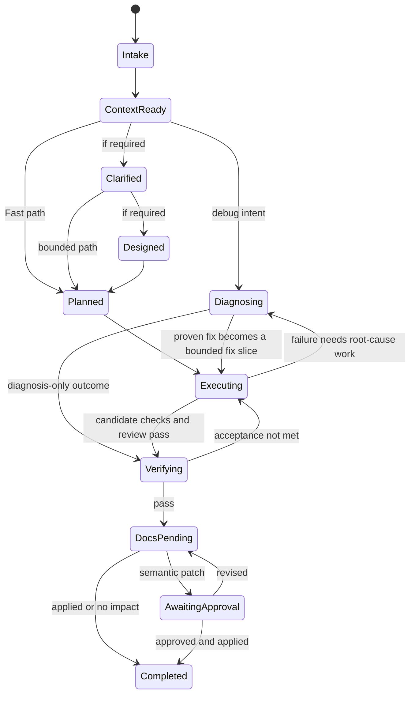

# Workflow

## User-facing commands and status

| Command | Intent | Runtime status |
|---|---|---|
| `$coding-sop` | Select the task intent and dispatch stages | **Current** prompt router; integrated lifecycle routing is Planned V1 |
| `$sop-init` | Establish or repair project context | **0.2 implemented** read-only InitReport kernel with **0.2.3** identity/confirmation hardening; Bootstrap/Adapt/Refresh docs workflow is Current; ContextBundle runtime is Planned V1 |
| `$sop-clarify` | Confirm a reviewable requirement | **Current 0.4.0** Superpowers-aligned interview, minimal Git requirements document, and exact Trace approval; richer automated question selection is Planned V1 |
| `$sop-design` | Select and approve a technical solution | **Current 0.4.0** Skill loads one exact approved `RequirementDocRef`; persisted DesignEngine is Planned V1 |
| `$sop-plan` | Convert one approved DesignDoc into detailed ordered vertical work | **Current** prompt Skill returns a Markdown PlanDoc; cross-session loading is Planned V1 |
| `$sop-execute` | Implement one approved PlanDoc serially through its gates | **Current** prompt Skill returns `ExecutionResult`; durable per-slice cursor/recovery is Planned V1 |
| `$sop-debug` | Diagnose and fix a reported failure | **Current** Skill; DiagnosisEngine is Planned V1 |
| `$sop-verify` | Evaluate acceptance using fresh evidence | evidence discipline plus 0.3 runtime completion/Docs Hook boundary; full VerifyGate/report is Planned V1 |
| `$sop-sync-docs` | Reconcile durable knowledge | **0.3** automatic post-verify classifier plus Current semantic preview/Skill; transactional DocsSyncEngine is Planned V1 |

The Current `$coding-sop` adapter must eventually call the same Planned V1 Runtime
stages; it cannot become a second lifecycle implementation.

## Automatic Execution Trace and Docs Hook (0.3 implemented)

Codex loads the plugin's `hooks/hooks.json` after installation. The user reviews
and trusts the exact Hook definition once through `/hooks`. The global Hook
receives subsequent lifecycle callbacks but remains a no-write filter until a
validated DevKit Runtime operation emits `workflow.started` for the current
Session. It then collects that plugin workflow's Turns, tool calls, permission
requests, compactions, subagents and stops without an Agent logging step or
background service. Sessions that do not use the plugin do not create a Trace.

`init_cli.py` automatically starts one Init run, records Phase 1 context
inspection and captures the safe pre-write docs inventory. The existing docs
validator completes the same run and records bounded recognized, generated,
overwritten, preserved, removed and conflicting path details. No extra Agent
inspection or Trace prompt is required. `workflow_cli.py` automatically records
Clarify start, approval request/resolution and completion. `runtime_cli.py`
validates route plus typed Design, Plan, Execute, Debug, Verify and Sync Docs
stage transitions. Every run has started/terminal timestamps and an exact
`stage_run_id`; approval pairs have an exact `approval_id`.
Before a completed TaskOutcome can be recorded, `workflow.finish` checks the
route-specific stage order, required approvals, passing verification, and the
matching Docs terminal facts. A missing stage is rejected rather than projected
as a successful workflow.
After `verification.complete` passes, the same call invokes Docs impact
classification from Git evidence. Routine bugs, tests, internal refactors and
temporary state return `NO_CHANGE`, so no docs question is shown. Semantic docs
work requires preview and confirmation. The normal workflow ends after the Docs
action is terminal and never derives or proposes Handoff work. Private
before/after inventories derive exact Docs changed paths without asking the
Agent to write Trace data. Human-facing Handoff documents are outside plugin
scope: no Skill, scan, question, migration, approval, or path-based Hook gate.

The old one-record `EvaluationTrace`, artificial oracle fields and
`evaluation_cli.py` are removed. This Collector does not make the remaining
Planned V1 automatic router or full WorkflowRuntime implemented.

### Explicit user direction (implemented)

The user's explicit skip/ignore instruction takes precedence over the plugin's
normal process gates. The router records `workflow.user_decision` once, without
requesting the same confirmation again. `skip_stage` removes that stage from
the remaining route; `waive_blocker` applies only to a named gate on the current
stage attempt. The other work and checks remain in force. A failed workflow
can continue on an explicit user decision while retaining its prior failure.

Decisions are bound to the current session, repository, route event and run.
A new route or run does not inherit older waivers. Downstream stages use the
user's selected input when an upstream stage was skipped or its failure was
accepted, without fabricating approved document references. Init exceptions do
not mark a blocked private InitReport ready.

`workflow.finish` honors those decisions and reports
`completed_with_exceptions`; failed tests remain failed and unrun checks remain
unrun. Skipped Verify emits no verification result. Unless Docs was also skipped,
`docs.classify` can inspect actual Git changes after a skipped Verify or accepted
failed Verify. An automatic Hook does not restart user-skipped Docs.

The packaged [user-direction reference](../plugins/ai-native-devkit/skills/coding-sop/references/user-direction.md)
defines the request shapes and stage-specific handling. These exceptions do not
create tool permissions, approval evidence, or a second workflow orchestrator.

### 0.2 implemented `$sop-init` kernel

The behavior below is implemented by the S0 runtime slice.

- S0 reads the selected repository but does not create, move or modify its files.
- A new invocation first performs the minimum read-only target classification
  needed to freeze an immutable TaskRequest, persists that request and the
  initial `Intake` checkpoint outside the repository, and only then performs full
  inspection.
- An eligible Target Repository is a non-bare Git worktree, normalized to its Git
  top-level. Unborn, dirty and detached-HEAD worktrees are eligible; a submodule
  selected from within the submodule is its own Target Repository. A non-Git path
  or bare repository returns a typed `blocked` InitReport. `$sop-init` does not run
  `git init`, clone or create a temporary worktree.
- `ContextReady` means inspection produced a trustworthy result. Confirmed missing
  entry docs, repository instructions or verification commands remain explicit
  gaps; uncertainty or an unresolved authoritative-source conflict that can
  change safe continuation blocks readiness.
- Same-directory `AGENTS.md` / `CLAUDE.md` comparison tolerates document-title
  and presentation differences, including corresponding host startup-rule links.
  It preserves meaningful section scopes, list nesting, code and other link targets.
  Residual differences are reported with paired file paths, original line ranges
  and bounded redacted excerpts; the Skill explains contradictions, complementary
  rules or uncertainty instead of treating every textual difference as a conflict.
- A user can select a reported file as the authority for this task and directory.
  A later confirmation submits `instruction_selection` bound to the exact latest
  blocked report. The private store records it before retrying; both source hashes
  are rechecked, stale choices are rejected, and directory groups can be resolved
  incrementally. Neither project file is rewritten and other tasks inherit no
  preference. Host instruction priority and repository-read boundaries still apply.
- The authoritative InitReport is a versioned structured artifact with
  `outcome: ready | blocked`. It contains bounded repository, source, finding,
  gap, blocker and artifact-reference data, not full raw file contents or unbounded
  command output. The Skill renders a concise Markdown view from it; that view is
  not another persisted contract. Runtime errors such as incompatible state,
  corruption or persistence failure are not report outcomes.
- S0 does not produce a RouteDecision or reusable ContextBundle. Both remain
  Planned V1 work.

## Prompt routing (Current)

The public router selects two independent dimensions and then emits one
compatibility route:

- `intent`: `development | debug`;
- `workflowTier`: `fast | standard | strict`;
- `route`: `lightweight | development | debug`.

| Compatibility route | Projection | Current flow |
|---|---|---|
| `lightweight` | development + fast; local low-risk behavior is already specified | context selection -> implementation -> fresh verification -> docs-impact conclusion |
| `development` | development + standard/strict; new behavior, ambiguity, multi-module work or architecture impact | clarify -> design -> plan -> execute -> verify -> docs sync as needed |
| `debug` | debug + any tier; bug, regression, failure or performance symptom | reproduce -> diagnose -> regression -> fix -> verify -> docs-impact conclusion |

## Workflow tiers (Current vocabulary; automated enforcement Planned V1)

Fast/Standard/Strict already describe process strength in the Current prompt
router. For example, a debug task can require Strict handling when it involves
authorization or a destructive repair. Planned V1 persists the decision and
automatically scores mandatory upgrades.

### Fast

Use when all are true:

- local and reversible change;
- no unresolved product meaning;
- no public contract, schema, permission or security change;
- small known write scope;
- existing verification command is available.

Flow:

```text
minimal context → implement or diagnose → targeted review/verify → docs-impact check
```

### Standard

Use for ordinary multi-file features and bugs with bounded design impact.

Flow:

```text
context → bounded clarification → concise design → approved PlanDoc
→ serial execution with candidate review, or debug → verify → docs sync
```

### Strict

Mandatory for architecture, cross-system ordering, data migration/backfill, authentication/authorization, secrets, destructive operations, difficult rollback or high operational impact.

Flow:

```text
full context and source conflict check
→ complete decision ledger
→ 2–3 approaches and section approval
→ ordered PlanDoc with applicable migration, rollback, security and manual gates
→ serial execution with explicit gates and candidate review
→ full verification
→ approved canonical-doc synchronization
```

Users may upgrade a route. Downgrading a mandatory Strict signal requires explicit acknowledgement and is recorded.

## 文档输出语言

各阶段默认使用简体中文生成文档的标题、正文、来源说明和计划模板，用户指定语言时优先遵从。
原始代码标识、JSON 字段、路径、引用和摘要保持不变；不得为了语言统一重写已批准的文档。
Clarify 默认省略 `document_language` 或使用 `zh-CN`；显式英文请求使用 `en`。

## Lifecycle

### Current 0.4.0 Clarify handoff

`inspect -> scope assessment -> one-question interview -> requirements.write ->
clarify.requirements request -> later-turn resolution -> exact Clarify terminal
-> requirements.load(purpose: design) -> Design start`.

If `requirements.load` detects source or document drift, Design does not start.
Return a bounded read-only report with the exact reference, affected path or
source, Loader code and message, recorded and current state, a safely available
bounded difference, and recommended next steps; then wait for explicit user
direction. Do not start Design or Clarify automatically.

If the user chooses requirement revision, enter the existing Clarify flow
explicitly: source drift uses the exact current reference as `supersedes`, while
document drift uses fresh `document_drift` mode without `supersedes`; the
changed, staged, committed, or deleted historical path is not restored or
overwritten, and the Writer creates a suffixed document with a new approval.
Rejected or changes-requested approval keeps Clarify active. Interrupted
pre-document interviews have no repository-level resume.

The full diagram is **Planned V1**. Current bounded runtimes enforce Init, the
exact Clarify approval boundary, Trace ordering, verification, and Docs Hook
transitions without claiming the complete persisted WorkflowRuntime.



Any active state may become `Blocked` with a typed reason. Resume returns to the prior state after its prerequisite is satisfied.

For S0, the InitReport, its supporting artifacts and any newly created lifecycle
transition are committed atomically. An initial `ready` report commits
`Intake -> ContextReady`; an initial `blocked` report commits `Intake -> Blocked`
and records the recovery condition without entering `ContextReady`. A repeated
Blocked report references that existing transition and creates no self-transition.

### Historical 0.2/0.2.3 clarification flow

Before 0.4.0, an in-progress interview first committed immutable
`draft` checkpoints. The 0.2.3 gate submitted the latest blocker-free draft for
approval and persisted an exact `approval_requested` checkpoint without advancing
lifecycle state. The then-current Skill presented its complete baseline and
exact reference, then ended the assistant turn. Only a later user-authored
approval permitted finalization; direct draft finalization was rejected.
Finalization atomically committed caller-asserted approval evidence, the
`ClarificationResult`, and the `ContextReady -> Clarified` transition. A failed
validation or commit exposed none of that batch. The runtime proved persisted ordering, not user-turn
authorship. This flow is unsupported in Current 0.4.0; its external state is
left untouched and is not migrated or deleted.

`$sop-debug` is therefore a first-class entry after context resolution; it does
not require a feature PlanDoc first. If the task includes a code fix, the proven
cause and regression seam are converted into a bounded fix slice before entering
`Executing`. A read-only diagnosis can proceed directly to `Verifying`.

## Stage gates

### Clarification gate

- project state and request scope were assessed before detailed questions;
- the interview is complete, with no blocking requirement ambiguity;
- the requirements document contains confirmed requirements but no solution
  design, architecture, test plan, or execution plan;
- optional sources identify exactly what they support;
- a later user turn approved the exact current `RequirementDocRef`.

### Design gate

- alternatives are genuinely distinct and compared consistently;
- selected approach covers architecture, components, data flow, error handling,
  and testing, with migration, rollout, rollback, and documentation impact only
  when they apply;
- relevant interfaces and seams are explicit;
- section check-ins are conversational feedback, not Runtime approvals;
- the complete stable design receives one final `design.solution` approval;
- no business ambiguity was silently decided.

### Planning gate

- the PlanDoc cites one complete approved DesignDoc and introduces no new
  solution decision;
- every ordered vertical slice produces an independently observable outcome;
- every material design requirement maps to a slice or Final integration;
- behavior slices identify their public seam, relevant Red, focused verification,
  and `Done when` condition;
- risk-specific detail appears only when migration, rollback, security,
  destructive action, or another approved design constraint requires it;
- no new material design decision is hidden in execution steps;
- a design or repository gap after Plan starts terminates that run with
  `stage.fail(plan.design_gap)` and stops before Execute.

### Serial slice execution gate

- public test seam identified;
- behavior-level Red observed when behavior changes;
- smallest implementation reaches Green;
- related tests and required static checks pass;
- any pre-existing staged, unstaged, or untracked change forces one clean
  isolated workspace for the whole PlanDoc; failure to isolate is a blocked
  Execute result and terminal `stage.fail`;
- every applicable Final integration check matches its `Expected` result before
  the candidate commit is created;
- the integrated candidate is reviewed against one pinned baseline on separate
  Spec and Standards axes;
- a changed candidate re-runs affected focused checks and the same Final
  integration gate before review and completion;
- `blocked`, `failed`, and `replan_required` each close the started Execute run
  with `stage.fail`; only `ExecutionResult.status: completed` advances the router
  to Verify, Docs Sync, and `workflow.finish`.

### Verification gate

- results are fresh for the candidate revision;
- applicable acceptance criteria have a numerator and denominator;
- original bug scenario is rerun for fixes;
- environment failures are reported as gaps, not successes;
- manual/UI checks include observable evidence where required.

### Documentation gate

- current, requested and proposed states remain distinguishable;
- doc destinations match their responsibility;
- semantic changes have approval;
- links, indexes and source metadata validate;
- SyncReceipt references the verified revision.
- human-facing Handoff documents remain outside plugin scope and are left untouched.

## Debug protocol

Current `$sop-debug` is a thin DevKit lifecycle adapter. It starts the typed
Debug run, invokes the packaged `$diagnosing-bugs` Skill for the diagnosis and
focused-fix method, completes or fails the retained run, then hands successful
work to `$sop-verify` and the automatic Docs Hook. `$diagnosing-bugs` can also
be called directly, but that standalone call does not provide the DevKit
Runtime, Verify, or Docs lifecycle.

The packaged method follows:

```text
feedback loop
→ exact reproduction
→ minimal reproduction
→ ranked falsifiable hypotheses
→ single-variable probes
→ correct-seam behavior regression
→ smallest proven fix
→ regression + original scenario
→ cleanup
```

If a red-capable feedback loop cannot be established, Debug fails with the
exact environment, logs, fixture, trace, or observability blocker. If the
proven fix requires architecture or public-contract changes, Debug fails with
`debug.design_required` instead of expanding scope inside the stage.

## User authority points

The runtime asks the user only when needed for:

- product meaning or acceptance policy;
- meaningful scope expansion;
- destructive or hard-to-recover actions;
- external messages, uploads, production changes or permission changes;
- semantic canonical-doc writes;
- override of a mandatory safety route;
- unresolved conflict between authoritative sources;
- approval of the exact committed requirements document in a later user turn;
- reuse of a task with a matching `ready` `$sop-init` report versus creation of a new Workflow Task.

Routine progress, local tests and reversible in-scope edits continue autonomously.

## Pause, resume and invalidation (Planned V1, with bounded 0.2 support)

Planned V1 makes every stage save:

- input contract IDs and hashes;
- current repo revision;
- output contract;
- evidence references;
- blocking reason, if any;
- next valid transition.

On resume, Planned V1 checks source and repo freshness and invalidates the
smallest affected downstream suffix. Current bounded behavior covers InitReport
reuse/new-task choice and exact approved `RequirementDocRef` consumption;
the remaining stages are prompt-driven and do not claim persisted suffix
invalidation. In particular, the Current PlanDoc remains in the response or an
already-ignored draft, and Execute has no durable per-slice cursor. Cross-session
PlanDoc selection, recovery of completed slices, and automatic restart from a
saved cursor remain Planned V1.

0.2 persistence is keyed by explicit `task_id`; repository path never selects
recent task state. For an initial init request with no `task_id`, `choice`, or
`authority_grant`, the adapter takes `CODEX_THREAD_ID`, then `CODEX_TASK_ID`, as
a candidate task ID, or generates a UUID when neither exists. If that implicit
candidate is already bound to a different repository target, the adapter creates
a fresh UUID-backed Workflow Task and leaves the existing task unchanged.
Explicit IDs and all follow-ups remain strict and fail with
`init.task_target_mismatch` on a target mismatch. Re-invoking a task whose latest
report is `ready` compares the current repository revision with its InitReport.
A match offers reuse without another transition or creation of a new task. A
mismatch projects the old immutable report as Stale and offers only new-task
creation or cancellation. The choice is revalidated before it is applied.

Re-invoking a Blocked task with its explicit `task_id` automatically rechecks its
prerequisite. If resolved, it resumes the prior `Intake` state and reruns
inspection. If still blocked, it persists fresh evidence and a new immutable
report whose `supersedes` reference preserves the earlier report. Starting
without that task identity creates a separate task.

`$sop-design` in a later session consumes a requirement only when the caller
supplies the exact `RequirementDocRef`, including path, commit, and blob digest,
and a completed approval exists for the same repository and exact subject. A
mismatch, missing document, source drift, pending request, rejection, or changes
request is rejected. The adapter must not infer a requirement from chat,
repository path, or recency.

## Rich workflow trace (0.3 observable-event slice implemented)

Planned V1 Trace is operational and evaluative, not private reasoning. It
records:

- task IDs and, after integrated routing exists, route IDs;
- stage transitions and reasons;
- source manifests and revisions;
- user questions/answers needed for authority;
- commands, durations, exit status and summarized output;
- test/review/verification counts;
- changed files and documentation decisions;
- retries, rework and unresolved risks.

It excludes secrets, browser tokens and hidden chain-of-thought. The 0.3
Execution Trace already captures supported Codex lifecycle events after plugin
activation plus validated DevKit runtime decisions. Full persisted stage engines,
review artifacts, retry policy and cross-host adapters remain Planned V1. A
Current Design or Plan approval may carry a caller-supplied document digest; the
Trace records that bounded identity without storing the document or turning it
into a resume cursor.
